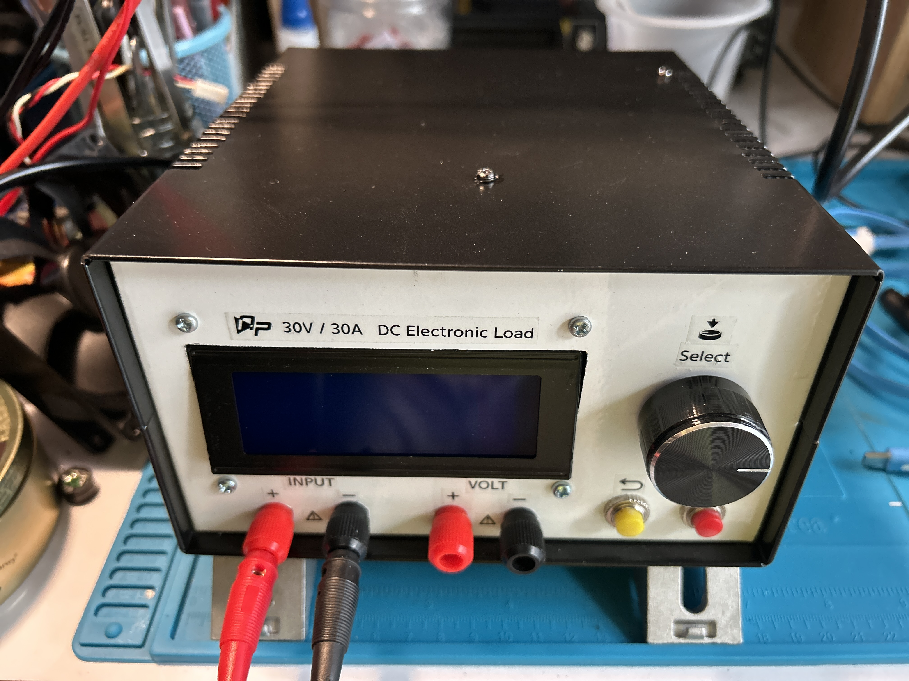
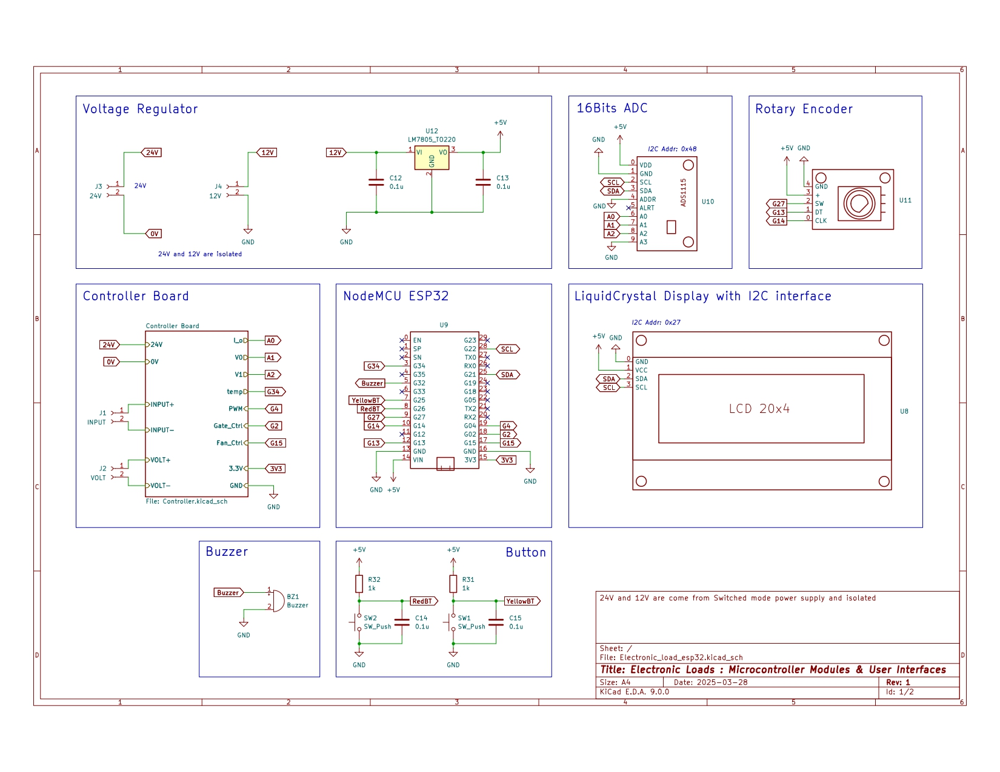
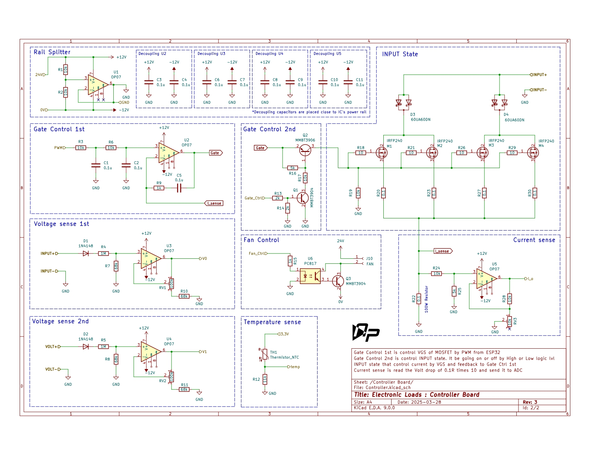

# ESP32 Electronic Load

**Firmware and KiCad design files for an ESP32-controlled programmable DC electronic load.**

  

## Overview

The project combines ESP32 firmware with a KiCad design. The firmware samples voltage and current through an ADS1115, controls the load through PWM, and provides an LCD and rotary-encoder interface.

## Key Features

- Constant-current, constant-power, and constant-resistance operating modes
- Digital voltmeter and PID tuning menus
- Non-blocking ADC sampling and cached LCD updates
- Battery capacity test with voltage cutoff, runtime limit, and mAh/Wh totals
- CSV voltage/current telemetry for [Serial Oscilloscope](https://github.com/xioTechnologies/Serial-Oscilloscope)
- KiCad schematic and PCB project files

## Specifications

| Firmware parameter | Value |
|---|---:|
| PID sample interval | 25 ms (40 Hz nominal) |
| Telemetry interval | 50 ms (20 records/s) |
| Serial baud rate | 115200 baud |
| Arduino CLI board target | `esp32:esp32:esp32` |

These are firmware settings. Electrical ratings and calibrated measurement limits are not established here.

## Architecture

The firmware sketch coordinates sensor sampling, control, menu input, display updates, and serial output. These responsibilities are split across sensor, capacity-test, display, and UI modules under `electronic_load_codeESP32_PID/`. The KiCad project is maintained separately under `Electronic_load_esp32/`.

### Design Considerations

- The serial stream contains numeric CSV records only: CH1 is selected voltage in volts and CH2 is current in amps.
- Default PID gains are Kp = 0.2, Ki = 10, and Kd = 0.0. The PID editor range is 0–0.8 for Kp/Kd and 0–15 for Ki.
- No external input source or load was connected during USB-only verification. Calibration and loaded control behavior remain unverified.

## Schematics

  

  

## Repository Structure

~~~text
Electronic_Load/
├── Electronic_load_esp32/          # KiCad schematic, PCB, and project files
├── electronic_load_codeESP32_PID/  # ESP32 sketch, firmware modules, and libraries
├── docs/                            # PDF schematic and project report
├── PICTURE/                         # Hardware photos, schematic images, and display artwork
├── logos/                            # Project and reference graphics
├── AGENTS.md                         # Contributor guidance
├── CHANGELOG.md                      # Project changes and verification notes
├── LICENSE                           # MIT License
└── README.md
~~~

## Usage and Development Notes

Install Arduino CLI and the ESP32 Arduino platform, then compile from the repository root:

~~~powershell
arduino-cli compile --fqbn esp32:esp32:esp32 --libraries .\electronic_load_codeESP32_PID\Inc .\electronic_load_codeESP32_PID
~~~

For Serial Oscilloscope, select the ESP32 COM port at 115200 baud and close Arduino Serial Monitor first. See [serial setup](electronic_load_codeESP32_PID/SERIAL_OSCILLOSCOPE.md).

## Results

The committed firmware clean-compiled and uploaded to an ESP32-D0WD-V3 on COM3. A USB-only capture after upload received 52 numeric CSV rows at 115200 baud. This confirmed serial framing; voltage/current calibration, rated operating limits, thermal performance, and control stability under load are **not verified**.

## Documentation

| Resource | Description |
|---|---|
| [Firmware changelog](CHANGELOG.md) | Confirmed changes and verification limits |
| [Serial Oscilloscope setup](electronic_load_codeESP32_PID/SERIAL_OSCILLOSCOPE.md) | CSV channels, baud rate, and connection notes |
| [KiCad schematic PDF](docs/Electronic_Load_sch.pdf) | PDF reference schematic |
| [Contributor guide](AGENTS.md) | Repository contribution and validation guidance |

## License

Licensed under the [MIT License](LICENSE).
